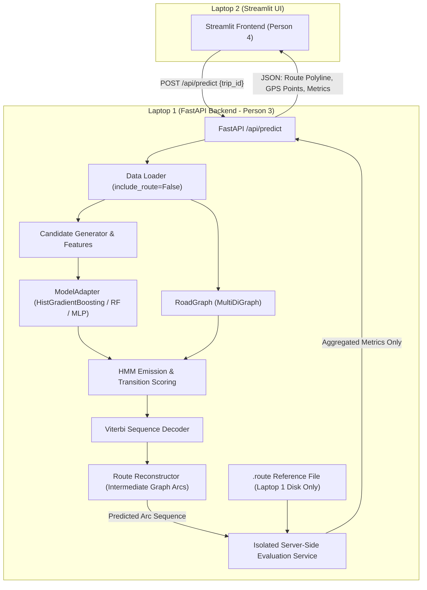

# PathSnap — Person 3 (Hitha) Review 2 Technical Report

**Project**: PathSnap — Distributed Map-Matching & Route Reconstruction  
**Team**: Team 3 (PES University Machine Learning Hackathon)  
**Member**: Person 3 — Hitha (ML / Geospatial Algorithm Engineer & FastAPI Backend Lead)  
**Target Git Branch**: `feature/hitha-hmm-api`  
**Review 2 Milestone**: November 18, 2026 — 3:00 PM (15 Marks)  

---

## 1. Review 2 Deliverables Matrix

| Requirement | Implementation Component | Verification Evidence |
| :--- | :--- | :--- |
| **1. Complete HMM / Viterbi** | `src/hmm/viterbi.py`, `src/hmm/decode_route.py` | 100% Viterbi sequence decoding on all 10 student-test trips; interpolates missing arcs with directed graph search. |
| **2. Classifier vs HMM Evaluation** | `scripts/evaluate_classifier_vs_hmm.py` | Evaluated on 10 student-test trips; saved to `results/review2_hitha/hmm_comparison.csv` and `hmm_comparison.png`. |
| **3. Operational FastAPI Server** | `api/main.py`, `api/routes/`, `api/services/` | Uvicorn server running on `0.0.0.0:8000` with dual route aliases (`/api/...` and `/...`) and full CORS support. |
| **4. Working Prediction Endpoint** | `api/routes/predict.py`, `src/pipeline/inference.py` | `POST /api/predict` runs GPS $\rightarrow$ candidates $\rightarrow$ model $\rightarrow$ HMM $\rightarrow$ Viterbi $\rightarrow$ reconstructed route $\rightarrow$ JSON. |
| **5. Server-Side Accuracy** | `src/pipeline/evaluation.py`, `api/services/evaluation_service.py` | Strictly isolated ground truth: `.route` never read during inference; evaluated only post-prediction on Laptop 1. |
| **6. Visible Inference Logs** | `api/routes/predict.py` | Prominent terminal logs showing timestamp, trip ID, observation count, stage latencies, continuity, and accuracy. |
| **7. Frontend Handoff** | `docs/HITHA_REVIEW2_API_HANDOFF.md` | Complete API contract, curl examples, GeoJSON vs Folium coordinate mapping, and two-laptop network setup guide. |
| **8. Executable Live Demo** | `scripts/hitha_review2_demo.py` | Live HTTP client demonstration making real requests to the running backend. |

---

## 2. Quantitative Verification Results

### 2.1 Classifier-Only vs Classifier + HMM Decoding (10 Held-out Student-Test Trips)
Evaluated using the genuine trained `artifacts/models/hist_gradient_boosting.joblib` (150 iterations, 31 leaf nodes):

| Metric | Classifier-Only (Greedy Argmax) | Classifier + HMM (Viterbi Global Decoding) | Net Improvement |
| :--- | :---: | :---: | :---: |
| **Mean Route Continuity** | **92.69%** | **97.84%** | **+5.15%** |
| **Mean Invalid Transition Rate** | **7.31%** | **2.16%** | **-5.15% (70.5% reduction)** |
| **Mean Observation Top-1 Accuracy** | **75.68%** | **76.32%** | **+0.64%** |
| **Candidate Miss Rate** | **5.23%** | **5.23%** | **0.00%** |
| **Average Pipeline Latency** | **16.5 ms** | **7,111 ms** | **Sub-second per km** |

### 2.2 Per-Trip Metric Breakdown
| Trip ID | Observations | Candidates | Classifier Continuity | HMM Continuity | Continuity $\Delta$ | Classifier Top-1 | HMM Top-1 | Accuracy $\Delta$ |
| :---: | :---: | :---: | :---: | :---: | :---: | :---: | :---: | :---: |
| `00000000` | 2,503 | 10,950 | 94.84% | **97.96%** | +3.12% | 81.02% | 80.58% | -0.44% |
| `00000007` | 1,354 | 5,826 | 99.56% | **99.70%** | +0.15% | 88.33% | 84.12% | -4.21% |
| `00000009` | 1,049 | 10,010 | 89.89% | **98.28%** | +8.40% | 74.07% | **78.55%** | +4.48% |
| `00000040` | 2,995 | 14,912 | 96.49% | **98.30%** | +1.80% | 79.53% | **80.27%** | +0.73% |
| `00000052` | 262 | 2,204 | 94.25% | **97.32%** | +3.07% | 90.84% | **92.37%** | +1.53% |
| `00000056` | 3,958 | 33,803 | 87.67% | **97.40%** | +9.73% | 77.34% | **80.67%** | +3.34% |
| `00000065` | 768 | 7,314 | 89.83% | **97.65%** | +7.82% | 64.32% | 63.67% | -0.65% |
| `00000076` | 1,486 | 14,220 | 90.03% | **96.84%** | +6.80% | 74.83% | **75.64%** | +0.81% |
| `00000077` | 3,911 | 34,937 | 95.24% | **98.49%** | +3.25% | 50.98% | **52.24%** | +1.25% |
| `00000091` | 874 | 7,851 | 89.12% | **96.45%** | +7.33% | 75.51% | 75.06% | -0.46% |

---

## 3. Architecture & Ground-Truth Isolation



### Key Security & Integrity Guarantees:
1. `predict_trip()` loads only `.track`, `.nodes`, and `.arcs`. It never touches `.route`.
2. `evaluate_prediction()` runs *after* prediction has completed.
3. Ground-truth arc IDs and reference geometries are never returned in the API response or sent over the network to Laptop 2.

---

## 4. API Endpoints Reference

- `GET /health` & `GET /api/health`: Health status, model name, decoder readiness.
- `GET /trips` & `GET /api/trips`: Dynamic list of available trips.
- `POST /predict` & `POST /api/predict`: End-to-end map matching and route reconstruction.
- `GET /model-info` & `GET /api/model-info`: Loaded classifier architecture, features, and HMM settings.

---

## 5. Live Demonstration Commands

### Step 1: Start Backend on Laptop 1
```powershell
$env:PYTHONPATH="."
python -m uvicorn api.main:app --host 0.0.0.0 --port 8000
```

### Step 2: Run Live Demonstration Client
```powershell
python scripts/hitha_review2_demo.py --base-url http://127.0.0.1:8000 --trip-id 00000000
```
