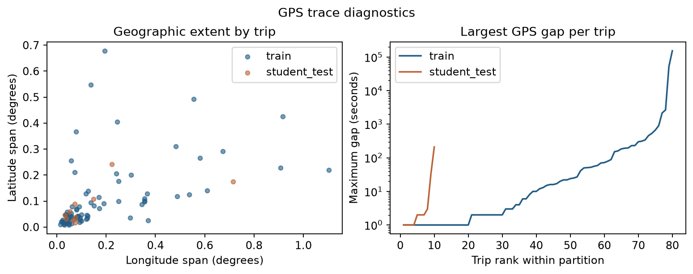

# EDA and preprocessing

The inventory and graph audit cover all supplied development trips.

| Measure | Train | Student-test |
| --- | ---: | ---: |
| Trips | 80 | 10 |
| GPS observations | 208,417 | 19,160 |
| Missing GPS rows in successfully parsed trips | 0 | 0 |
| Out-of-range GPS coordinate pairs | 0 | 0 |
| Nonpositive timestamp steps | 0 | 0 |
| Gaps over 5 seconds | 1,216 | 44 |
| Gaps over 60 seconds | 69 | 1 |
| Maximum gap (seconds) | 153,064 | 210 |
| Isolated road nodes | 0 | 0 |
| Trips with multiple weakly connected road components | 79 | 10 |
| Trips with multiple strongly connected road components | 80 | 10 |
| Reference transitions failing direct connectivity | 13 / 31,256 | 1 / 3,467 |

Weak components ignore arc direction. Strong components require directed
reachability in both directions. The largest weak component held at least
69.28% of the nodes per training trip and 87.40% per student-test trip. Even
graphs with zero isolated nodes can have separate groups of roads.

Training traces span longitudes −100.42° to 137.24° and latitudes −34.64°
to 61.27°. Student-test spans longitudes −93.42° to 77.27° and latitudes
42.65° to 61.70°. The figure shows the geographic extent and maximum time
gap of each trip.

## Preprocessing policy

The parser rejects missing or non-finite numeric values, invalid longitude
or latitude, and arc or route IDs outside their trip's graph. It preserves
file order and zero-based IDs. The feature pipeline converts coordinates
into a trip-local metric plane before distance calculations.

The pipeline retains observed points across large time gaps and does not
interpolate. Speed uses displacement divided by positive elapsed time.
The first observation has missing motion features. Nonpositive time steps
leave speed missing, and zero displacement leaves heading error missing.
Model imputers fill missing features using training-fold statistics.

The longest training gap occurs in trip `00000090`. Displacement and
heading across long gaps can be poor proxies for motion on an individual
road. The policy preserves the shared training data and candidate keys used
by all teammates.

Run `python -m scripts.analyze_data` to regenerate the per-trip diagnostics.
For a Folium inspection of the GPS trace, road network, and reference route,
run `python -m scripts.make_map data/raw/train/00000001 --out artifacts/maps/trip_00000001.html`.
