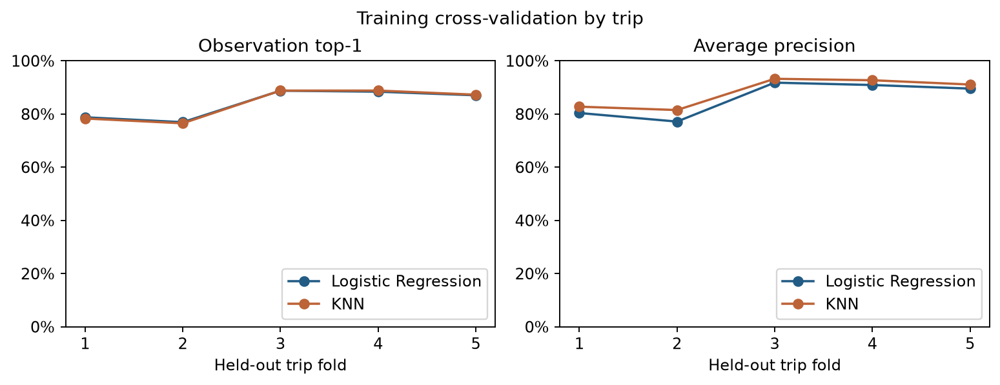
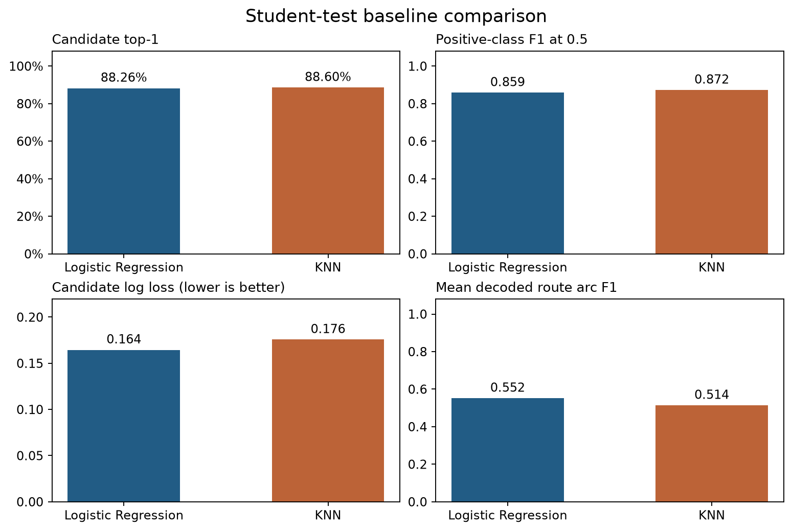

# Logistic Regression and KNN

Both models use the same nine features and weak labels. Five-fold GroupKFold
keeps entire trips together, with imputation and scaling fitted inside each
training fold. Rows with blank labels are excluded from fitting. Logistic
Regression uses L2 regularization. KNN uses 15 neighbors with distance
weighting and fits a reproducible, stratified sample of up to 25,000
candidate rows. The original baselines keep their fixed settings. The
optional Optuna search selects parameters on training folds only.

## Training validation

| Model | Mean average precision | Mean observation top-1 |
| --- | ---: | ---: |
| Logistic Regression | 0.8597 | 83.99% |
| KNN | 0.8827 | 83.95% |

## Student-test evaluation

| Metric | Logistic Regression | KNN |
| --- | ---: | ---: |
| Candidate top-1 | 88.26% | 88.60% |
| Positive-class F1 at 0.5 | 0.8586 | 0.8725 |
| Macro F1 at 0.5 | 0.9117 | 0.9201 |
| Candidate log loss with RF clipping | 0.1645 | 0.1756 |
| Pre-decoder direct continuity | 93.58% | 93.26% |
| Mean post-Viterbi continuity | 99.98% | 99.98% |
| Mean decoded route arc F1 | 0.5517 | 0.5137 |
| Exact ordered route matches | 0/10 | 0/10 |

Candidate metrics use 10,271 weakly labeled GPS observations. Pre-decoder
continuity pools 10,261 within-trip pairs of successive labeled
observations and counts pairs whose predicted arcs are identical or share
the appropriate directed endpoint. This is the Random Forest continuity
definition. For direct comparison, evaluate all models on the same
observations. The log loss column clips probabilities to
[1e-7, 1 − 1e-7], matching Random Forest. The original log loss without
that explicit clipping was 0.1645 for Logistic Regression and 0.2524 for KNN.

Post-Viterbi continuity is a mean over all 10 trips. It checks whether the
decoded observations can be joined along the road network. Route arc F1
measures overlap with the reference by counting matching arc occurrences.
Exact route match also checks order and requires zero disconnections.

KNN led slightly on candidate top-1 and positive-class F1. Logistic
Regression had lower candidate log loss and higher route arc F1. Both
produced connected routes in most transitions, with zero exact route
matches in the student-test runs.

See the [baseline results](../../docs/baseline_results.md) and the
[comparison CSV for the team](../data/student_test_baseline_summary.csv).
Regenerate the result tables with `python -m scripts.export_results`.
